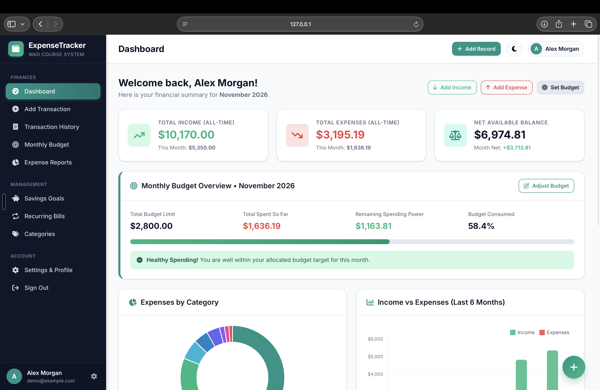
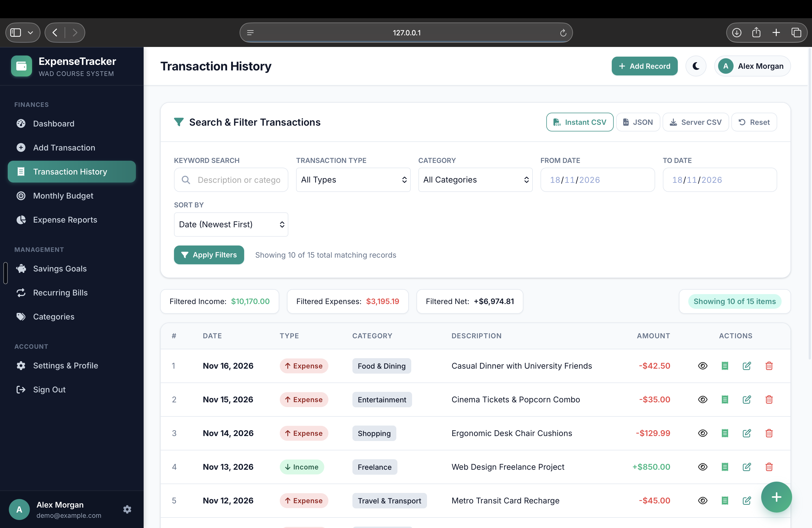
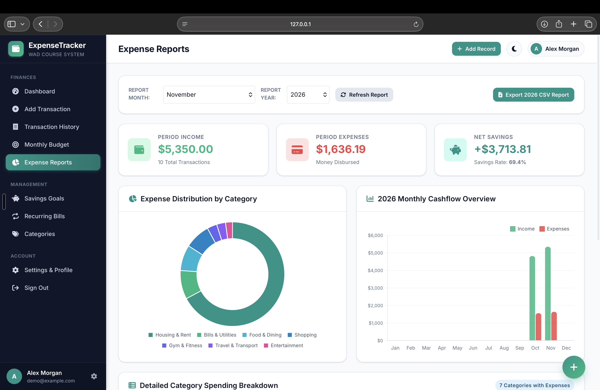
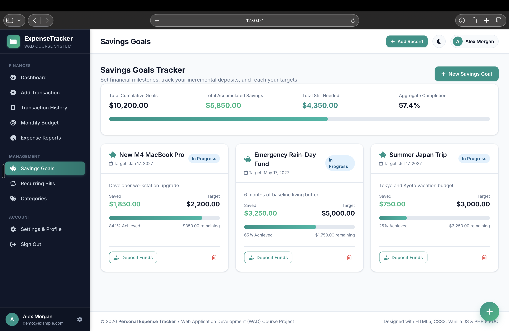
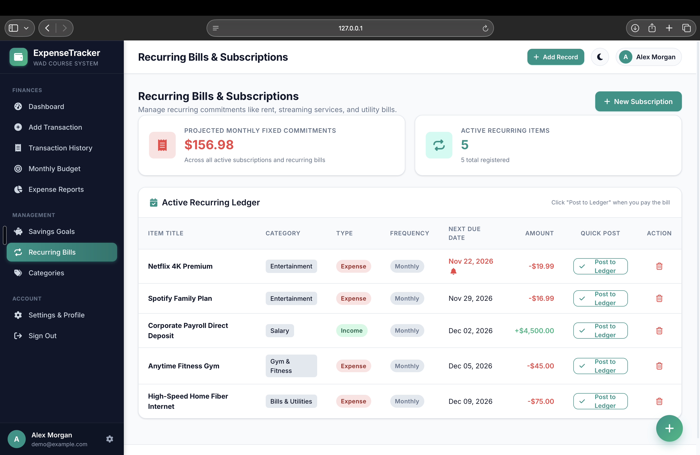
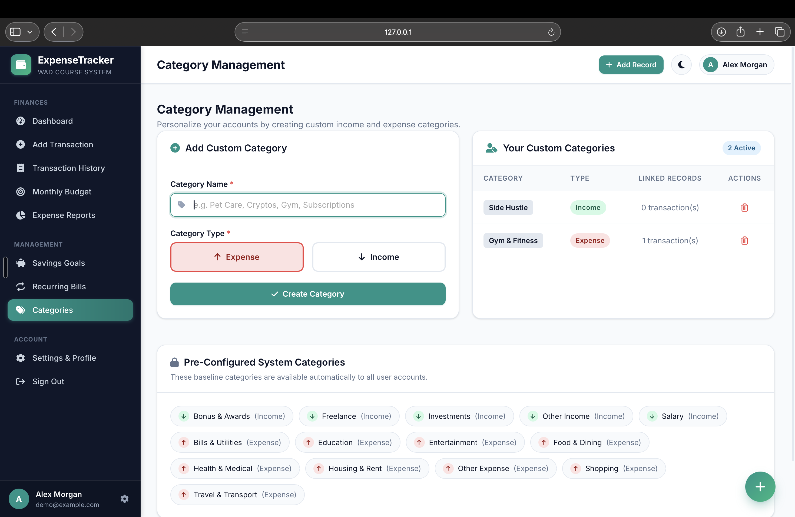
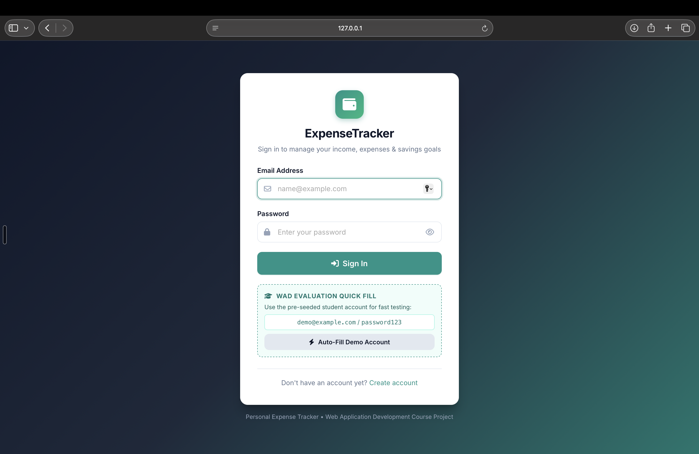

# Personal Expense Tracker: A Web-Based Income and Expense Management System

A full-stack, enterprise-grade, secure web application engineered for the **Web Application Development (WAD)** course project. Built using **pure PHP 8 (PDO)**, **MySQL**, **HTML5**, **CSS3**, and **Vanilla JavaScript** (with Chart.js via CDN for interactive visualization).

---

## 📋 Table of Contents
1. [Project Overview](#-project-overview)
2. [Complete Feature Suite](#-complete-feature-suite)
3. [Technology Stack](#-technology-stack)
4. [Folder & File Architecture](#-folder--file-architecture)
5. [Database Architecture & Relational Schema](#-database-architecture--relational-schema)
6. [Installation & Setup Guide (XAMPP / WAMP)](#-installation--setup-guide-xampp--wamp)
7. [Pre-configured Demo Credentials](#-pre-configured-demo-credentials)
8. [Team Work Division (4-Member Team)](#-team-work-division-4-member-team)
9. [Security Implementation Guide](#-security-implementation-guide)
10. [Viva Voce Questions & Presentation Guide](#-viva-voce-questions--presentation-guide)

---

## 🌟 Project Overview
Managing personal finances, monitoring daily expenses, saving for future milestones, and keeping track of recurring subscription commitments are essential life skills. **Personal Expense Tracker** provides users with an intuitive, responsive dashboard to manage their entire financial lifecycle in one place.

The system calculates real-time net cashflow, tracks monthly budgets with adaptive color-coded warnings (Green / Amber / Red), enables goal-oriented savings deposits, monitors periodic subscription bills, manages custom user categories, supports live search and filters, and exports data to CSV spreadsheets.

---

## 📸 Application Preview & Screenshots

| Main Dashboard | Transaction History & Live Filter |
| :---: | :---: |
|  |  |

| Expense Reports & Analytics | Savings Goals Tracker |
| :---: | :---: |
|  |  |

| Recurring Bills & Subscriptions | Category Management |
| :---: | :---: |
|  |  |

| Modern Authentication & Sign In |
| :---: |
|  |

---

## 🚀 Complete Feature Suite

### 1. User Authentication & Authorization
- **Session-Based Security:** Safe registration, login, and logout workflows utilizing PHP session management.
- **Cryptographic Password Protection:** Passwords securely hashed with `password_hash()` (BCrypt) and verified with `password_verify()`.
- **Session Fixation Prevention:** Calls `session_regenerate_id(true)` upon successful user sign-in.
- **Strict Data Isolation:** Prepared statement queries bind the authenticated user's ID (`WHERE user_id = :user_id`) to ensure users only access and modify their own records.

### 2. Analytical Dashboard
- **Financial Metric Cards:** Real-time totals for **Total Income**, **Total Expenses**, and **Net Available Balance** (all-time & current month).
- **Monthly Budget Progress Tracker:** Real-time budget progress bar that updates dynamically from **Green** (<80%) to **Amber** (80%–99%) and **Red** (≥100% with warning alert).
- **Interactive Visualizations (Chart.js):**
  - **Doughnut Chart:** Proportionate expense breakdown by category with currency tooltips.
  - **Grouped Bar Chart:** 6-month historical cashflow comparison between income and expenses.
- **Recent Activity Ledger:** The 5 most recent transactions with type indicators and direct editing links.

### 3. Add Income & Expense Module
- **Dual-Purpose Smart Form:** Intuitive radio toggle between **Expense (Money Out)** and **Income (Money In)**.
- **Dynamic Category Filter:** Vanilla JS automatically filters the category list in real-time based on the selected transaction type.
- **Two-Tier Validation:** Client-side JavaScript validation (positive amounts, non-empty date, required category) reinforced by server-side PHP validation.
- **CSRF Defense:** Embedded cryptographic token on all form submissions.

### 4. Transaction History, Search & Filtering
- **Tabular Ledger:** View every transaction with color-coded badges (`+` Green for Income, `-` Red for Expense).
- **Multi-Parametric Filter Bar:** Filter simultaneously by text keyword (description/category), type (Income/Expense), category dropdown, and custom Date Ranges (`From` / `To`).
- **Configurable Sorting:** Sort by Date (Newest/Oldest) or Amount (Highest/Lowest).
- **Live Query Totals:** Computes the exact income, expense, and net variance of the currently filtered search result.
- **Server-Side Pagination:** Smooth 10 records per page using SQL `LIMIT` and `OFFSET` while preserving active query strings across page switches.
- **Transaction Inspector Modal:** Inspect full record timestamps and metadata without leaving the page.
- **Safe Record Deletion:** Confirmation dialog combined with CSRF-validated POST deletion.

### 5. Monthly Budget Planner
- Establish spending limits for any month and year.
- Computes actual expenditures against the target using MySQL aggregation.
- Tracks historical budget performance and net savings across past months.

### 6. Expense Reports & CSV Export
- Comprehensive monthly or annual financial statements.
- Calculates **Savings Rate (%)** reflecting financial discipline.
- Categorical distribution table with percentage breakdown and visual share bars.
- **One-Click CSV Export:** Streams a formatted CSV file with a UTF-8 Byte Order Mark (BOM) for compatibility with Microsoft Excel, Google Sheets, and Apple Numbers.

### 7. 🌟 NEW: Custom Category Management (`pages/categories.php`)
- Users can create custom categories for tailored financial tracking (e.g., *Gym Membership*, *Cryptos*, *Side Hustle*, *Pet Care*).
- Supports distinct categorization for both Incomes and Expenses.
- Relational integrity check: prevents deletion of categories currently referenced by existing transactions to avoid orphaned rows.

### 8. 🌟 NEW: Savings Goals Tracker (`pages/goals.php`)
- Set milestone targets (e.g. *Emergency Fund*, *New Laptop*, *Japan Vacation*).
- Track target amount, saved amount, target completion date, and motivational notes.
- Visual horizontal progress meters calculating percent achieved and remaining deficit.
- **Interactive "Deposit Funds" Modal:** Incrementally allocate savings toward specific goals; automatically marks goals as *Completed* when reached!

### 9. 🌟 NEW: Recurring Subscriptions & Bills (`pages/recurring.php`)
- Track periodic commitments (Netflix, Spotify, Gym, Cloud Hosting, Rent, Corporate Salary).
- Configure frequencies: *Weekly*, *Monthly*, or *Yearly*.
- Proactive due date tracking with reminder indicators for bills due within 7 days.
- **One-Click "Post to Ledger":** Directly records the recurring charge into the primary `transactions` ledger and automatically advances the `next_due_date` by +1 cycle!

### 10. 🌟 NEW: Multi-Currency & Dark Mode Theme (`pages/profile.php`)
- **Multi-Currency Support:** Switch between `$`, `₹` (INR), `€` (EUR), `£` (GBP), `¥` (JPY), `C$` (CAD), `A$` (AUD), and `AED` with immediate display across all financial views.
- **Dark Mode / Light Mode Switcher:** Topbar toggle button with smooth CSS transitions and `localStorage` persistence.
- **Change Password Module:** In-app credential updating with verification of the user's existing password.

---

## 💻 Technology Stack

| Layer | Technology | Description |
| :--- | :--- | :--- |
| **Frontend** | HTML5 Semantic Elements | Accessible and responsive document markup |
| **Styling** | CSS3 (Variables, Flexbox, Grid) | Soft teal/emerald theme, Dark Mode support, card-based responsive design |
| **Client Scripting** | Vanilla JavaScript (ES6+) | Dynamic category filtering, DOM manipulation, client validation, modal managers |
| **Charts** | Chart.js 4 (via CDN) | Lightweight Canvas-based interactive charts |
| **Icons** | Font Awesome 6 (via CDN) | Modern vector iconography |
| **Backend** | PHP 8+ | Procedural / Simple OOP using PHP Data Objects (PDO) |
| **Database** | MySQL / MariaDB | Relational database with Foreign Keys & `ON DELETE CASCADE` |
| **Environment** | XAMPP / WAMP / MAMP | Standard Apache & MySQL server stack |

---

## 📂 Folder & File Architecture

```
expense-tracker/
├── index.php                      # Application entry point router (redirects to dashboard or login)
├── database.sql                   # MySQL schema, relational constraints & initial seed data
├── README.md                      # Complete project documentation & viva guide
├── config/
│   └── db.php                     # PDO database connection with error handling
├── includes/
│   ├── functions.php              # Global helpers: currency format, theme, sanitize, CSRF, session
│   ├── auth_check.php             # Authentication gatekeeper middleware
│   ├── header.php                 # HTML <head>, CDN assets, topbar, theme toggle, flash banners
│   ├── sidebar.php                # Responsive sidebar navigation with active page states
│   └── footer.php                 # Closing tags, scripts injection, and footer metadata
├── auth/
│   ├── login.php                  # User login authentication controller & view (with demo autofill)
│   ├── register.php               # User registration controller & view
│   └── logout.php                 # Session destruction & cookie purging
├── pages/
│   ├── dashboard.php              # Analytical overview, KPI cards, charts & recent records
│   ├── add_transaction.php        # Transaction form with dynamic category selection
│   ├── edit_transaction.php       # Transaction update form with IDOR protection
│   ├── history.php                # Filterable transaction table with pagination & modal
│   ├── budget.php                 # Monthly spending targets & historical variance
│   ├── reports.php                # Period reports, categorical shares & savings rates
│   ├── categories.php             # Custom category management module
│   ├── goals.php                  # Savings goals tracker with deposit modal
│   ├── recurring.php              # Subscriptions & recurring bills with "Post to Ledger"
│   └── profile.php                # Profile settings, multi-currency selector & password change
├── actions/
│   ├── save_transaction.php       # Action: validates & inserts transaction into database
│   ├── update_transaction.php     # Action: validates ownership & updates record
│   ├── delete_transaction.php     # Action: verifies CSRF & deletes user record
│   ├── save_budget.php            # Action: inserts or updates monthly budget limit
│   ├── export_csv.php             # Action: streams filtered records to CSV download
│   ├── save_category.php          # Action: creates custom user category
│   ├── delete_category.php        # Action: safe deletion of custom category
│   ├── save_goal.php              # Action: creates new savings goal
│   ├── deposit_goal.php           # Action: adds incremental funds to a goal
│   ├── delete_goal.php            # Action: removes savings goal
│   ├── save_recurring.php         # Action: creates recurring commitment
│   ├── process_recurring.php      # Action: posts recurring charge to transactions ledger
│   ├── delete_recurring.php       # Action: removes recurring subscription
│   ├── update_profile.php         # Action: updates name, email, currency & theme
│   └── change_password.php        # Action: verifies current password and updates hash
└── assets/
    ├── css/
    │   └── style.css              # Master stylesheet (Teal theme, Dark mode, Print styles)
    └── js/
        ├── main.js                # Theme switcher, mobile drawer, alert timers, password toggle
        ├── validation.js          # Real-time form validation & dynamic category switching
        └── charts.js              # Chart.js initialization for doughnut and bar charts
```

---

## 🗄 Database Architecture & Relational Schema

The database consists of **6 relational tables** with foreign key constraints and cascade rules:

1. **`users`**: User accounts, credentials, preferred currency symbol (`$`, `₹`, `€`, etc.), visual theme preference (`light`/`dark`).
2. **`categories`**: Default categories (`user_id = NULL`) and user-created custom categories (`user_id = users.id`).
3. **`transactions`**: Primary ledger records linked to `user_id` and `category_id`.
4. **`budgets`**: Monthly limits unique per `(user_id, month, year)`.
5. **`savings_goals`**: User milestones with `target_amount`, `saved_amount`, and target completion dates.
6. **`recurring_transactions`**: Subscriptions and repetitive bills with automated cadence (`frequency`) and `next_due_date`.

---

## 🛠 Installation & Setup Guide (XAMPP / WAMP)

Follow these steps to deploy and run the application locally using XAMPP:

### Step 1: Start Apache & MySQL
1. Open the **XAMPP Control Panel**.
2. Click **Start** next to **Apache** and **MySQL** (both status indicators turn green).

### Step 2: Copy to `htdocs`
Copy the `expense-tracker` folder into your web server document root:
- **Windows:** `C:\xampp\htdocs\expense-tracker`
- **macOS:** `/Applications/XAMPP/xamppfiles/htdocs/expense-tracker`
- **Linux:** `/opt/lampp/htdocs/expense-tracker`

### Step 3: Import Database (`database.sql`)
1. Open **phpMyAdmin** in your browser: [http://localhost/phpmyadmin](http://localhost/phpmyadmin)
2. Click on the **Import** tab.
3. Select `expense-tracker/database.sql` and click **Import**.
4. The database `expense_tracker` will be created with all 6 tables and comprehensive demo data.

### Step 4: Open in Browser
Navigate to:
```
http://localhost/expense-tracker
```

---

## 🔑 Pre-configured Demo Credentials

| Field | Value |
| :--- | :--- |
| **Email Address** | `demo@example.com` |
| **Password** | `password123` |
| **One-Click Fill** | Click **"Auto-Fill Demo Account"** on the login screen. |

---

## 👥 Team Work Division (4-Member Team)

| Member | Primary Responsibility | Files Owned / Developed | Key Deliverables |
| :--- | :--- | :--- | :--- |
| **Member 1**<br>*(Frontend & Layout)* | **Dashboard UI, Theme Engine & CSS Architecture** | • `assets/css/style.css`<br>• `includes/header.php`<br>• `includes/sidebar.php`<br>• `includes/footer.php`<br>• `pages/dashboard.php`<br>• `pages/profile.php` | • CSS variable architecture & soft teal/emerald theme<br>• Dark Mode / Light Mode switcher with localStorage persistence<br>• Responsive mobile drawer navigation<br>• Dashboard KPI cards, budget progress bar & print styles |
| **Member 2**<br>*(Client Logic & Forms)* | **Add/Edit Forms, Client Validation & Dynamic Categories** | • `pages/add_transaction.php`<br>• `pages/edit_transaction.php`<br>• `pages/categories.php`<br>• `assets/js/validation.js`<br>• `assets/js/main.js` | • Dual-purpose Income/Expense interactive toggle<br>• Real-time client-side category filtering (DOM manipulation)<br>• Category management interface & validation<br>• Form inputs, alert dismissal timers & password toggle |
| **Member 3**<br>*(Backend & Database)* | **PHP Architecture, MySQL Database & Security** | • `database.sql`<br>• `config/db.php`<br>• `includes/functions.php`<br>• `includes/auth_check.php`<br>• `auth/*.php`<br>• `actions/save_transaction.php`<br>• `actions/update_transaction.php`<br>• `actions/delete_transaction.php`<br>• `actions/update_profile.php`<br>• `actions/change_password.php` | • Relational schema with Foreign Keys (`ON DELETE CASCADE`)<br>• PDO connection with native prepared statements<br>• BCrypt authentication & session fixation prevention<br>• CSRF token generation & validation system<br>• User profile settings & password update handling |
| **Member 4**<br>*(Analytics, Goals & Subscriptions)* | **History, Reports, Savings Goals & Subscriptions** | • `pages/history.php`<br>• `pages/budget.php`<br>• `pages/reports.php`<br>• `pages/goals.php`<br>• `pages/recurring.php`<br>• `actions/save_budget.php`<br>• `actions/export_csv.php`<br>• `actions/save_goal.php`<br>• `actions/deposit_goal.php`<br>• `actions/process_recurring.php`<br>• `assets/js/charts.js` | • Search & multi-filter query builder with pagination<br>• Savings goals tracking with deposit modal<br>• Recurring subscriptions with "Post to Ledger" action<br>• Chart.js Doughnut and Bar Chart integration<br>• UTF-8 CSV data export pipeline |

---

## 🔒 Security Implementation Guide

1. **SQL Injection**: Prepared statements via PDO with `$pdo->prepare()` and parameter binding (`:param`). Native prepares are enforced (`PDO::ATTR_EMULATE_PREPARES => false`).
2. **Cross-Site Scripting (XSS)**: Escaped with the helper function `e()` (`htmlspecialchars(..., ENT_QUOTES, 'UTF-8')`).
3. **Cross-Site Request Forgery (CSRF)**: Cryptographic tokens generated per session and validated with `hash_equals()`.
4. **Broken Access Control & IDOR**: Database queries enforce user isolation with `WHERE user_id = :user_id`.
5. **Session Security**: Cookies set with `HttpOnly` and `SameSite = 'Lax'`. Session ID regenerated on login via `session_regenerate_id(true)`.
6. **Relational Data Integrity**: Foreign keys with `ON DELETE CASCADE` ensure child records are cleanly cleared when a user is deleted, while categories verify usage before deletion.

---

## 🎓 Viva Voce Questions & Presentation Guide

### Questions for Member 1 (UI/UX & CSS Architecture)
- **Q1: How is Dark Mode implemented without external JavaScript libraries?**
  - *Answer:* We define color variables under `:root` for Light Mode and override those variables under `[data-theme="dark"]`. When the user toggles the theme button, JavaScript toggles `data-theme="dark"` on `<html>` and stores the selection in browser `localStorage`.
- **Q2: How did you ensure printing reports looks professional?**
  - *Answer:* We defined `@media print` rules in CSS that hide navigation elements (sidebar, topbar, action buttons, modals) so that clicking "Print" produces a clean, white-background financial statement ready for PDF export.

### Questions for Member 2 (JavaScript & Form Handling)
- **Q1: How does the dynamic category filtering work?**
  - *Answer:* Each `<option>` carries a `data-type="income"` or `data-type="expense"` attribute. When the transaction type radio changes, our event listener filters out non-matching options by setting `.hidden = true` and `.disabled = true`.
- **Q2: What happens if a user tries to delete a category that is already used in transactions?**
  - *Answer:* In `actions/delete_category.php`, we execute a query `SELECT COUNT(*) FROM transactions WHERE category_id = :id`. If count > 0, the deletion is rejected with a warning message, preventing broken foreign key relationships.

### Questions for Member 3 (Backend & Database Architecture)
- **Q1: Why did you use `hash_equals()` instead of `===` for CSRF verification?**
  - *Answer:* Standard string comparison (`===`) stops as soon as a mismatched character is found, creating a potential timing attack vulnerability. `hash_equals()` compares in constant time, preventing attackers from measuring execution duration.
- **Q2: How does the system handle multi-currency?**
  - *Answer:* The user's preferred currency symbol (e.g., `$`, `₹`, `€`, `£`) is stored in the `users` table and cached in `$_SESSION['user_currency']`. The global function `format_currency($amount)` reads this session value to format numbers across all views.

### Questions for Member 4 (Analytics, Goals & Subscriptions)
- **Q1: How does the "Post to Ledger" action work for Recurring Bills?**
  - *Answer:* When clicked, `actions/process_recurring.php` inserts a new transaction into the `transactions` table using the recurring item's amount and category. It then calculates the next due date based on its frequency (+1 week, +1 month, or +1 year) and updates `recurring_transactions.next_due_date`.
- **Q2: How are savings goals calculated and marked as completed?**
  - *Answer:* Each goal tracks `target_amount` and `saved_amount`. When a user deposits funds via `actions/deposit_goal.php`, the system adds the deposit, calculates progress percentage, and if `saved_amount >= target_amount`, automatically sets `status = 'completed'`.
